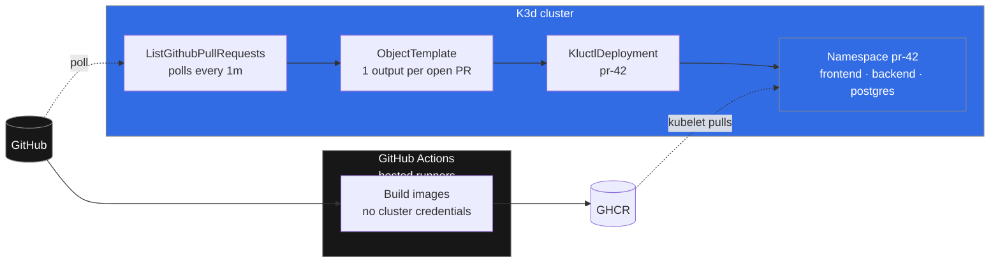

# Ephemeral Preview Environments

Every open pull request has a live, isolated environment — its own frontend, backend, database and URL. Close the PR and it disappears.

Self-hosted on K3d with pull-based GitOps. Same idea as Vercel Preview Deployments, built on open-source tooling.

```
PR #42 opened  →  http://pr-42.local.127.0.0.1.nip.io
PR #42 closed  →  gone
```

---

## The one idea worth knowing

The obvious build is event-driven: PR opens → deploy, PR closes → destroy. That has a structural flaw. A webhook is an **event** — miss it and you are permanently out of sync. Close a PR while the machine is asleep and its environment lives forever, because the moment that was meant to clean it up has passed and will not come again.

This is built the other way round. Nothing reacts to a PR closing. A controller in the cluster continuously asks *"which PRs are open right now?"* and makes reality match:

```
open pull requests on GitHub  ←── desired state
              ▼
 running preview environments ←── actual state
```

There is no cleanup code in this repository. Teardown is a property of the system.

---

## How it works



Three resources own the whole lifecycle:

| Resource | Job |
|---|---|
| `ListGithubPullRequests` | Polls the GitHub API, publishes open PRs to its `status` |
| `ObjectTemplate` | Treats that list as a matrix, renders one `KluctlDeployment` and one `GithubComment` each |
| `KluctlDeployment` | Deploys that PR's branch into `pr-<number>` |

When a PR closes it leaves the list, the matrix input vanishes, and both generated objects are pruned.

**GitHub Actions only builds images**, on hosted runners. There is no self-hosted runner and no cluster credential anywhere in CI.

The PR comment is posted from inside the cluster too. A comment written by a build job is a snapshot — if the environment dies an hour later it still claims to be live. This one is generated from the same matrix as the deployment, so it exists exactly as long as the pull request does.

---

## Setup

### 1. Cluster

```bash
k3d cluster create ephemeral-envs \
  -p "80:80@loadbalancer" -p "443:443@loadbalancer"
```

That is all it needs. Images come from GHCR, so there is no local registry to run and nothing to configure in your Docker daemon.

### 1b. Make the image packages public

After the first build pushes them, set both packages to public under **GitHub → Packages → package → Settings → Change visibility**:

- `ephemeral-envs-backend`
- `ephemeral-envs-frontend`

Package visibility is independent of repository visibility, so a private repo can publish public images. This is what lets preview namespaces pull without an `imagePullSecret` — which would otherwise mean putting a registry token in Git.

### 2. Controllers

```bash
kluctl controller install

kubectl apply -f https://raw.githubusercontent.com/kluctl/template-controller/v0.9.4/deploy/manifests/template-controller.yaml
```

### 3. Credentials

```bash
kubectl apply -f gitops/rbac.yaml

# One secret, two consumers: `token` for the GitHub API,
# `username`/`password` for cloning this private repo.
kubectl create secret generic github-credentials \
  --namespace ephemeral-envs-system \
  --from-literal=token=ghp_xxx \
  --from-literal=username=gg-push \
  --from-literal=password=ghp_xxx
```

The token needs `repo` scope.

### 4. Start the generator

```bash
kubectl apply -f gitops/preview-generator.yaml
```

Open a pull request. An environment appears within a minute or two.

### 5. Looking at environments

Nothing needs installing in the cluster for this. k3s already ships
metrics-server, so per-namespace resource usage works out of the box:

```bash
kubectl top pod -n pr-5
kubectl logs -n pr-5 -l app=devboard -f
kubectl get events -n pr-5 --sort-by=.lastTimestamp
```

For an interactive view, [k9s](https://k9scli.io) is a single binary that runs
on your machine and adds nothing to the cluster:

```bash
k9s -n pr-5     # l logs · d describe · s shell · y yaml · :ns switch namespace
```

---

## Working on it locally

The project the controller deploys is the same one you can drive from a shell — no separate templating step, no commit-and-see-what-happens.

```bash
# What would change if PR 42 deployed right now?
kluctl diff -t preview -a pr_number=42 -a image_tag=<sha>

# Render everything, no cluster needed
kluctl render -t preview --offline-kubernetes \
  -a pr_number=42 -a image_tag=<sha> --print-all

# Deploy by hand, bypassing GitOps
kluctl deploy -t preview -a pr_number=42 -a image_tag=<sha>
```

---

## Layout

```
.kluctl.yaml                 Targets, args, pruning discriminator
deployment.yaml              Deployment order and common labels
deploy/
  namespace/                 Namespace + ResourceQuota
  postgres/                  Database + seed data
  backend/                   FastAPI
  frontend/                  React
  ingress/                   Traefik routing
gitops/
  rbac.yaml                  Namespace + scoped ServiceAccounts
  preview-generator.yaml     The entire PR lifecycle, declared
app/                         FastAPI source + tests
frontend/                    React source
.github/workflows/
  ci.yml                     Lint, test, render, validate — hosted runners
  pr-preview.yml             Build and push images — self-hosted
  pr-closed.yml              Corrects the PR comment — hosted runners
```

No `kustomization.yaml` files under `deploy/` — kluctl generates one for any directory that lacks it.

---

## Design decisions

**No `namePrefix`.** Each environment is alone in its namespace, so the Postgres Service is `postgres` everywhere and `DATABASE_URL` is a constant. The previous version prefixed every resource name, which forced per-PR rewriting of the database hostname and caused a string of bugs.

**The discriminator includes the PR number.** kluctl uses it to decide which objects a deployment owns and may prune. A shared discriminator would mean deploying PR 2 prunes PR 1.

**Images are tagged with the head SHA.** A mutable `pr-42` tag cannot answer "which commit is running here." An immutable one can, and it makes every push a real change rather than a no-op.

**Liveness and readiness probe different endpoints.** `/api/health` checks the database and returns 503 when it is unreachable, so readiness pulls the pod from the Service. `/api/live` touches nothing, so a slow Postgres cannot cascade into restarting the app.

**`deployInterval: 5m`.** Environments redeploy on a timer even with no changes, so manual edits are corrected instead of drifting.

**No dashboard.** The PR comment carries the URL and the reviewer is already on the PR — the same interface Vercel and Netlify use. `kubectl get ns` and `kluctl webui` cover the operator view.

---

## Testing

```bash
pip install -r app/requirements-dev.txt
ruff check . && pytest
```

CI additionally renders the project offline and asserts the templated values. That step matters more than it looks: **a Jinja2 typo does not fail, it renders an empty string.** `{{ args.pr_numbr }}` would silently produce a namespace called `pr-`, shared by every environment. CI checks the rendered output so that fails loudly.

---

## Security

- **No self-hosted runner.** Everything in CI runs on GitHub-hosted runners. Nothing in this repository can cause code to execute on the cluster operator's machine.
- **CI holds no cluster credentials.** Delivery is pull-based; CI only builds and pushes images.
- **Fork branches never become environments.** `ListGithubPullRequests` filters on `head: gg-push:.*`, so only branches in this repository are deployed. This is the guard that matters if the repo is public — without it, anyone could open a PR and have their branch run in the cluster.
- **The deployer ServiceAccount is scoped** to the resource types a preview environment is made of, not cluster-admin.

## Running it on a real cluster

The only laptop-specific value is `base_domain` in `.kluctl.yaml`. Point it at a wildcard domain and the same project deploys unchanged.

Three of the gaps below stop being optional at that point, which is really what separates a laptop setup from a server one:

- **TLS** — cert-manager with a DNS-01 wildcard certificate
- **Auth** — the environments are on the internet now
- **TTL** — idle environments cost money once you are paying for the node
- **Retained metrics** — `kubectl top` and k9s answer "what is happening now", which is all a dev cluster needs. A server wants history, and that means an actual metrics stack (`kube-prometheus-stack`, most likely)

---

## Known gaps

Deliberately out of scope for now — see `plan.md`.

| Gap | Why |
|---|---|
| No Basic Auth on environments | A generated password cannot be committed to Git; every fix adds a component. Everything is on `127.0.0.1` and the repo is private. |
| No TTL | Closed PRs are cleaned up. A PR left open for a month keeps its environment. |
| No retained metrics | `kubectl top` and k9s show current state only. Fine for a dev cluster; a server would want a real metrics stack. |

---

## Why kluctl, not ArgoCD or Flux

All three do GitOps. The differences that decided it:

- **Flux** has no pull-request generator. The dynamic part — one environment per open PR — would have been mine to build and maintain.
- **ArgoCD** solves it well with `ApplicationSet`, and is the better-known tool. But per-PR values thread through `spec.source.kustomize.patches`, which is awkward, and a full install is ~6 pods on a laptop that is already busy.
- **kluctl** has the same generator concept, native Jinja2 so per-PR values are just `{{ args.pr_number }}` inline, and — the decider — **the same project deploys identically from the CLI and the controller**, so `kluctl diff` shows exactly what GitOps will do.

The concepts are identical across all three, so this cost nothing conceptually and bought a much better local loop.
