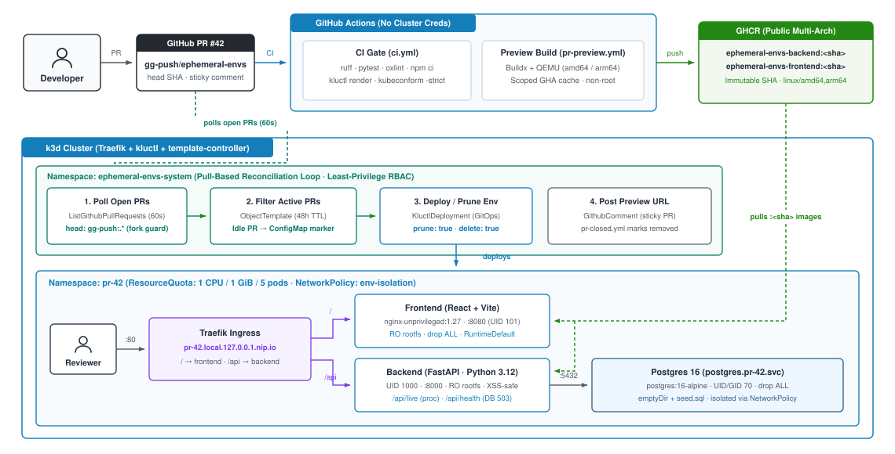

# Ephemeral Preview Environments

[](https://github.com/gg-push/ephemeral-envs/actions/workflows/ci.yml)

Every open pull request gets a live, isolated preview environment — its own React frontend, FastAPI backend, PostgreSQL 16 database, `NetworkPolicy`, and URL. Close the PR or leave it idle for 48 hours and the environment is pruned automatically.

```text
PR #42 opened  →  http://pr-42.local.127.0.0.1.nip.io   ~90s
PR #42 closed  →  gone                                  ~60s
```

## The Idea

Event-driven preview setups break when a webhook is missed or a laptop is asleep when a PR closes. Instead, a controller inside the cluster continuously polls GitHub for open pull requests and reconciles cluster state to match. Nothing pushes into the cluster, and CI holds zero cluster credentials.

## Architecture



`ListGithubPullRequests` polls GitHub every 60s (restricted to same-repo branches via `head: gg-push:.*`). `ObjectTemplate` renders one `KluctlDeployment` per active PR (within a 48h idle TTL). Closing a PR or exceeding 48h of inactivity removes the `KluctlDeployment`, and `delete: true` deletes the entire `pr-<n>` namespace. `pr-closed.yml` only updates the sticky PR comment so no dead URL remains on the closed PR.

## Setup

```bash
# 1. Cluster (Traefik and metrics-server ship with k3s)
k3d cluster create ephemeral-envs -p "80:80@loadbalancer" -p "443:443@loadbalancer"

# 2. Controllers
kluctl controller install
kubectl apply -f https://raw.githubusercontent.com/kluctl/template-controller/v0.9.4/deploy/manifests/template-controller.yaml

# 3. Least-privilege RBAC and GitHub credentials
kubectl apply -f gitops/rbac.yaml
kubectl create secret generic github-credentials -n ephemeral-envs-system \
  --from-literal=token=ghp_xxx \
  --from-literal=username=<you> \
  --from-literal=password=ghp_xxx

# 4. Start the reconciliation loop
kubectl apply -f gitops/preview-generator.yaml
```

GHCR packages are public so preview namespaces pull multi-arch (`linux/amd64`, `linux/arm64`) images without committing registry tokens to Git.

## Working on It

The project the controller reconciles is the same project you drive from the CLI:

```bash
kluctl diff   -t preview -a pr_number=42 -a image_tag=<sha>   # preview changes
kluctl render -t preview -a pr_number=42 --offline-kubernetes --print-all
kluctl deploy -t preview -a pr_number=42 -a image_tag=<sha>   # direct deploy
```

Inspect a live environment with `kubectl top pod -n pr-42` or `k9s -n pr-42`.

## Repository Layout

```text
.kluctl.yaml               Targets, args, per-PR pruning discriminator
deployment.yaml            Deployment ordering and common labels/annotations
deploy/                    Templated manifests (namespace, NetworkPolicy, postgres, backend, frontend, ingress)
docs/architecture.svg      Pull-based GitOps & isolated preview architecture diagram
gitops/
  rbac.yaml                Least-privilege ServiceAccounts (preview-templater, preview-deployer)
  preview-generator.yaml   Declarative PR open/close/48h-idle lifecycle
app/  frontend/            Hardened non-root FastAPI + React/Nginx preview application
.github/workflows/         CI (ruff, pytest, kluctl + kubeconform, oxlint/vite) & multi-arch Buildx publish
```

No `kustomization.yaml` under `deploy/` — `kluctl` generates one automatically for each directory.

## Key Engineering Decisions

- **Kluctl over ArgoCD/Flux:** `kluctl` templates `{{ args.pr_number }}` inline without Kustomize patch gymnastics, and `kluctl diff` runs the exact same deployment code locally that the in-cluster controller runs.
- **No `namePrefix`:** Every environment runs inside its own `pr-<n>` namespace, so Postgres is `postgres` everywhere (`postgres.pr-<n>.svc`) and `DATABASE_URL` never varies.
- **Immutable head-SHA image tags + multi-arch Buildx:** Built once per commit for `linux/amd64` and `linux/arm64` with scoped GHA caches (`scope=backend`, `scope=frontend`).
- **Separate `/api/live` & `/api/health` probes:** `/api/health` checks PostgreSQL and returns `503` on failure (pulling unready pods from Service endpoints); `/api/live` checks only the process so a slow DB never triggers a restart loop.
- **Defense-in-depth per preview namespace:** Non-root containers (`UID 1000` backend, `UID 101` unprivileged Nginx on `:8080`, `UID 70` Postgres), `readOnlyRootFilesystem: true`, `capabilities.drop: ["ALL"]`, `RuntimeDefault` seccomp, `automountServiceAccountToken: false`, `ResourceQuota`, and `NetworkPolicy` (`env-isolation`) blocking cross-namespace DB access.

## Known Gaps (Local Laptop vs. Production Cluster)

| Gap | Why |
|---|---|
| No auth on preview URLs | Generated passwords cannot live in Git; local previews bind to `127.0.0.1` via `nip.io`. Production adds `oauth2-proxy` as a Traefik middleware. |
| Self-signed/HTTP on localhost | Production adds `cert-manager` DNS-01 wildcard certs (`*.preview.example.com`) to avoid Let's Encrypt rate limits and CT-log leaks. |
| No retained metrics | `kubectl top` and `k9s` cover local inspection; production attaches Prometheus/Grafana scraping `/metrics`. |
