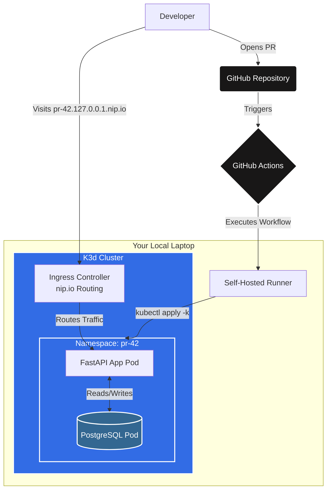

# 🚀 Ephemeral Preview Environments

> Every pull request gets its own live environment. Automatically.

---

## What Is This?

You know that feeling when someone opens a PR and says *"can you review this?"* — but to actually test it, you have to pull the branch, set up a database, run migrations, and hope nothing conflicts with your local setup?

This project fixes that.

When a pull request is opened on GitHub, a fully isolated environment is automatically spun up on a Kubernetes cluster — with its own app instance, its own database, and its own URL. When the PR is closed or merged, everything is torn down automatically. No manual cleanup. No shared staging environment. No "works on my machine."

This is the same concept behind **Vercel Preview Deployments** and **Netlify Deploy Previews** — but self-hosted, on your own infrastructure, using open-source tools.

---

## How It Works



---

## Tech Stack

| Tool | Purpose |
|---|---|
| **K3d** | Local Kubernetes cluster (K3s inside Docker) |
| **Kustomize** | Deploy and template app per environment without heavy Helm charts |
| **Nginx Ingress** | Route traffic to the correct namespace |
| **nip.io** | Free wildcard DNS (no domain purchase needed) |
| **GitHub Actions** | Trigger deploy/cleanup on PR events |
| **GHCR** | Store Docker images (GitHub Container Registry) |
| **PostgreSQL** | Per-environment isolated database |
| **Python / FastAPI** | Sample app used to demonstrate the system |

---

## Why K3d Instead of K3s, Minikube, or Kind?

Great question. There are several ways to run Kubernetes locally and they all look similar on the surface. Here is why K3d was the right choice for this project:

### K3s (the raw version)
K3s is fantastic — it is a lightweight, production-grade Kubernetes distribution made by Rancher. But installing it directly on your machine means it runs as a **system service**. Tearing it down requires running an uninstall script, and it leaves behind network interfaces and config files. For a development tool you want to spin up and destroy frequently, that is painful.

### Minikube
Minikube is the most well-known option and works great. But it is **heavier** — it typically spins up a full virtual machine (or a Docker container with more overhead), takes 1-2 minutes to start, and feels slow compared to alternatives. It is better suited for running Kubernetes once and leaving it, not for repeatedly creating and deleting clusters.

### Kind (Kubernetes IN Docker)
Kind is excellent for CI/CD testing pipelines and is very lightweight. The downside is that it has **less built-in support** for things like Ingress and LoadBalancer services, which are central to this project. Getting traffic routing to work requires extra steps.

### K3d ✅ (what we use)
K3d wraps K3s inside Docker containers. This gives you the best of both worlds:

- **One command to create:** `k3d cluster create mycluster`
- **One command to destroy:** `k3d cluster delete mycluster`
- **Fast:** Cluster is ready in ~30 seconds
- **Clean:** Everything lives in Docker. Delete the cluster, Docker cleans up. No leftover system files.
- **No extra dependencies:** If you have Docker, you have everything you need.
- **Ingress support:** Works out of the box with port mapping to your local machine.

For a project where the cluster is a dev tool rather than a permanent installation, K3d is simply the most ergonomic choice.

---

## Prerequisites

- Docker (running)
- k3d
- kubectl
- A GitHub account

---

## Quick Start

```bash
# 1. Create the cluster
k3d cluster create ephemeral-envs --port "80:80@loadbalancer" --port "443:443@loadbalancer"

# 2. Verify it's running
kubectl get nodes

# 3. Tear it all down when done
k3d cluster delete ephemeral-envs
```

---

## Project Structure

```
ephemeral-envs/
├── app/                    # Sample Python FastAPI app
│   ├── main.py
│   ├── models.py
│   ├── database.py
│   ├── requirements.txt
│   └── Dockerfile
├── k8s/                    # Kustomize configurations
│   ├── base/               # Base YAML manifests
│   └── cluster-infra/      # Global cluster resources (e.g., TTL CronJob)
├── .github/
│   └── workflows/
│       ├── pr-deploy.yml   # Deploy on PR open
│       └── pr-cleanup.yml  # Destroy on PR close
├── plan.md
└── README.md
```

---

## Security Note

This project uses a **self-hosted GitHub Actions runner**. The runner executes jobs directly on your local machine, which means it has access to your K3d cluster.

**The repository is kept private for this reason.** Using a self-hosted runner with a public repository is a security risk — anyone could open a PR and execute arbitrary code on your machine via the runner.

---

## What This Demonstrates

- **Kubernetes**: Namespace isolation, Ingress routing, resource quotas, CronJobs
- **Kustomize**: Overlays, dynamic patching, declarative configuration
- **GitOps mindset**: Infrastructure driven by Git events
- **CI/CD**: Event-driven automation with GitHub Actions
- **Platform thinking**: Building tools that make other developers' lives easier
