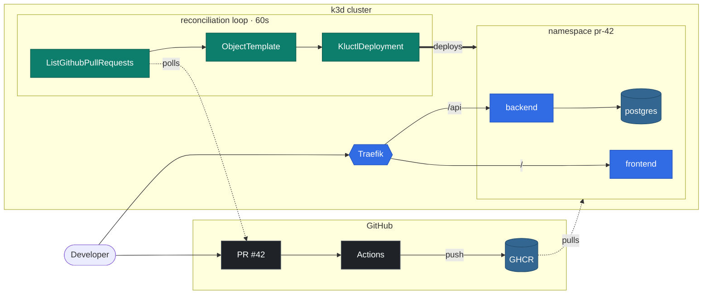

# Ephemeral Preview Environments

Every open pull request has a live, isolated environment — its own frontend, backend, database and URL. Close the PR and it disappears.

```
PR #42 opened  →  http://pr-42.local.127.0.0.1.nip.io   ~90s
PR #42 closed  →  gone                                  ~60s
```

## The idea

The obvious build is event-driven: PR opens → deploy, PR closes → destroy. That has a structural flaw. A webhook is an **event** — miss it and you are permanently out of sync. Close a PR while the machine is asleep and its environment lives forever.

So nothing here reacts to a pull request closing. A controller inside the cluster continuously asks GitHub *which pull requests are open* and makes reality match the answer. There is no cleanup code in this repository.

## Architecture



The arrow that matters is the dotted one from `ListGithubPullRequests` back to GitHub. It points *into* the cluster's control loop, not out of GitHub. Nothing is ever pushed at the cluster, so there is no delivery to fail and no event to miss.

Teardown falls out of the same mechanism. A closed PR leaves the list → the matrix input vanishes → the generated `KluctlDeployment` is pruned → `delete: true` removes everything it created.

Idle expiry is the same again: a PR untouched for 48h fails the condition, stops being generated, and is pruned. Push to it and the condition flips back, so there is no restore path to implement.

## Setup

```bash
# 1. Cluster (Traefik and metrics-server ship with k3s)
k3d cluster create ephemeral-envs -p "80:80@loadbalancer" -p "443:443@loadbalancer"

# 2. Controllers
kluctl controller install
kubectl apply -f https://raw.githubusercontent.com/kluctl/template-controller/v0.9.4/deploy/manifests/template-controller.yaml

# 3. RBAC and credentials
kubectl apply -f gitops/rbac.yaml
kubectl create secret generic github-credentials -n ephemeral-envs-system \
  --from-literal=token=ghp_xxx \
  --from-literal=username=<you> \
  --from-literal=password=ghp_xxx

# 4. Start the loop
kubectl apply -f gitops/preview-generator.yaml
```

The GHCR packages must be **public** so preview namespaces pull without an `imagePullSecret` — otherwise a registry token has to live in Git. Package visibility is independent of repository visibility.

## Working on it

The project the controller runs is the same one you can drive from a shell:

```bash
kluctl diff   -t preview -a pr_number=42 -a image_tag=<sha>   # what would change
kluctl render -t preview -a pr_number=42 --offline-kubernetes --print-all
kluctl deploy -t preview -a pr_number=42 -a image_tag=<sha>   # bypass GitOps
```

Looking at a running environment needs nothing installed in the cluster:

```bash
kubectl top pod -n pr-42
k9s -n pr-42
```

## Layout

```
.kluctl.yaml               targets, args, pruning discriminator
deployment.yaml            deployment order, common labels
deploy/                    templated manifests, one dir per component
gitops/
  rbac.yaml                scoped ServiceAccounts
  preview-generator.yaml   the entire PR lifecycle, declared
app/  frontend/            the application being previewed
.github/workflows/         lint + test + render; build images
```

No `kustomization.yaml` under `deploy/` — kluctl generates one for any directory without it.

## Decisions

**kluctl over ArgoCD/Flux.** Flux has no pull-request generator, so the dynamic part would be mine to maintain. ArgoCD's `ApplicationSet` fits but threads per-PR values through awkward kustomize patches. kluctl templates them inline as `{{ args.pr_number }}`, and the same project runs from the CLI and the controller — so `kluctl diff` shows exactly what GitOps will do.

**No `namePrefix`.** Each environment is alone in its namespace, so the Postgres Service is `postgres` everywhere and `DATABASE_URL` is a constant.

**Images tagged with the head SHA.** A mutable `pr-42` tag cannot answer "which commit is running here."

**`prune` ≠ `delete`.** `prune` removes orphaned objects during a reconcile; `delete` removes everything when the `KluctlDeployment` goes away. Only setting the first leaks a namespace per closed PR, silently.

**Liveness and readiness probe different endpoints.** `/api/health` checks the database and returns 503 when it is unreachable. `/api/live` touches nothing, so a slow Postgres cannot cascade into restarting the app.

**CI holds no cluster credentials**, and `ListGithubPullRequests` filters on `head:` so fork branches never become environments.

## Known gaps

| Gap | Why |
|---|---|
| No auth on environments | A generated password cannot be committed to Git. Everything is on `127.0.0.1`. |
| No retained metrics | `kubectl top` and k9s show current state only. A real server would want a metrics stack. |

## Running on a real cluster

The deployment project, generator, controllers, RBAC, CI and images are unchanged. Four things differ:

**Domain.** Set it in three places — the `base_domain` arg in `.kluctl.yaml`, the URL in the `GithubComment` body in `gitops/preview-generator.yaml`, and the assertion in `ci.yml`. Point a wildcard `*.preview.example.com` A record at the server.

**TLS.** cert-manager with a DNS-01 wildcard certificate. Per-environment HTTP-01 certs hit Let's Encrypt rate limits and publish every branch name to Certificate Transparency logs.

**Auth.** oauth2-proxy as a Traefik middleware — one GitHub OAuth app, no per-environment secret to generate or rotate.

**Isolation.** Default-deny NetworkPolicies between preview namespaces. Postgres uses the same credentials in every namespace.

Both gaps above stop being optional at that point, and scale-to-zero starts paying for itself.
